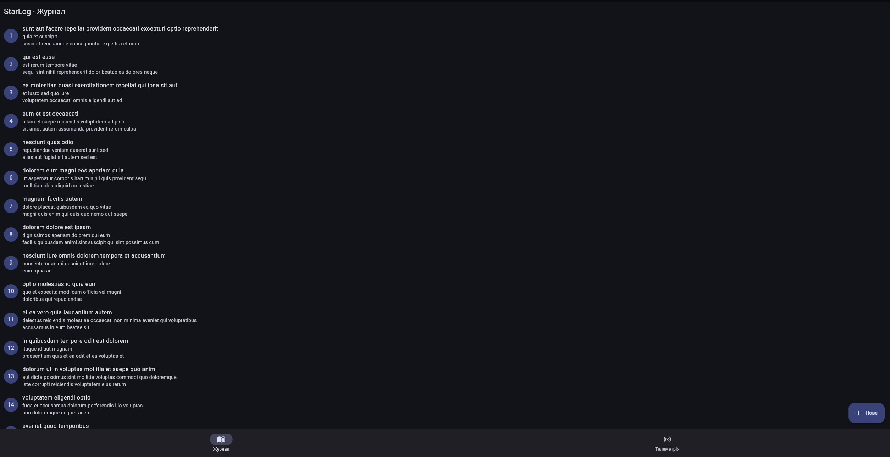
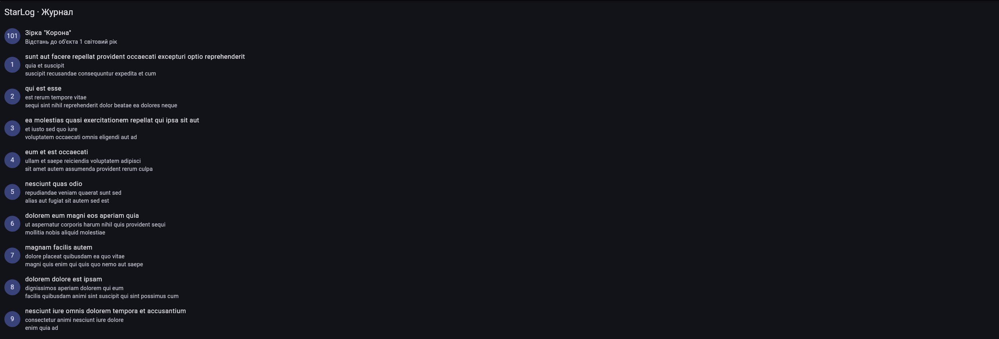
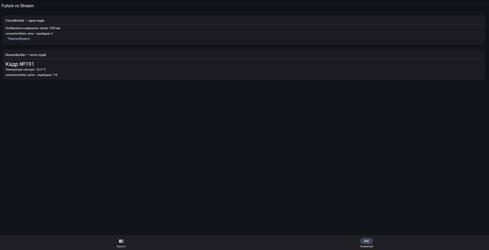

# lab6_async_rest — StarLog Mobile

Мобільний клієнт StarLog (ЛР №6): асинхронність, Stream та REST API
у Flutter. Дані журналу беруться з публічного тестового API
jsonplaceholder: пост трактується як запис журналу спостережень
(title — об’єкт, body — нотатки).

## Функціонал

- GET /posts — список записів (FutureBuilder: очікування, помилка, дані);
- POST /posts — створення запису (JSON-тіло, Content-Type: application/json);
- індикатор завантаження (CircularProgressIndicator) і кнопка «Повторити»;
- pull-to-refresh (RefreshIndicator);
- обробка помилок: HTTP-статус, тайм-аут, відсутність мережі (SnackBar);
- потік телеметрії кожні 2 секунди (async* + StreamBuilder);
- екран «Future vs Stream» з порівнянням обох підходів.

## Скріншоти





## Структура проєкту

    lib/main.dart                         точка входу, тема, навігація
    lib/models/post.dart                  модель Post, fromJson
    lib/models/telemetry_reading.dart     показання телеметрії
    lib/services/api_service.dart         ApiService: getPosts, createPost
    lib/services/telemetry_service.dart   Future.delayed, Stream (async*)
    lib/screens/posts_screen.dart         список, POST, Retry, RefreshIndicator
    lib/screens/live_screen.dart          Future vs Stream

## Як це працює

- Future і async/await. Метод calibrate() чекає 3 секунди через
  Future.delayed і повертає рядок; FutureBuilder показує спінер, потім текст.
- GET і JSON. ApiService.getPosts() перевіряє statusCode == 200,
  розбирає тіло через jsonDecode і Post.fromJson.
- POST. ApiService.createPost() відправляє jsonEncode({title, body, userId})
  і чекає статус 201.
- Помилки. Мережеві винятки (SocketException, TimeoutException,
  ClientException, FormatException) перетворюються на ApiException з
  повідомленням для користувача; його показують SnackBar або екран з Retry.
- Stream. readings() — генератор async*, що видає нове показання кожні
  2 секунди; StreamBuilder оновлює екран на кожну подію.

## Різниця між Future і Stream

| | Future | Stream |
| --- | --- | --- |
| Скільки значень | одне (або помилка) | нуль, одне або багато з часом |
| Приклад у проєкті | getPosts(), calibrate() | readings() — кадр кожні 2 с |
| Віджет | FutureBuilder | StreamBuilder |
| Перебудови | зазвичай дві: waiting і done | на кожну нову подію |
| Завершення | після першого результату | коли потік закрито або скасовано підписку |

Future підходить для одноразового результату (запит до сервера),
Stream — для послідовності подій у часі (лічильник, телеметрія).

## Запуск

    flutter pub get
    flutter analyze
    flutter run

У GitHub Codespaces (веб-версія, відкрийте порт 8080 на вкладці Ports):

    flutter run -d web-server --web-port 8080 --web-hostname 0.0.0.0

## Примітка про POST

Сервер jsonplaceholder імітує створення: відповідає 201 і повертає
запис з id 101, але не зберігає його. Тому застосунок додає створений
запис угору списку локально.

## Відповіді на контрольні запитання

1. У чому принципова різниця між Future та Stream у Dart, і коли доцільно використовувати кожен з них?
Future представляє одне значення (або помилку), яке з’явиться пізніше, і завершується після першого результату. Stream — це послідовність асинхронних подій у часі: нуль, одна чи багато значень, які можна слухати доти, доки потік не закрито. Future доцільний для одноразових операцій, як запит getPosts() до сервера. Stream використовують для подій, що повторюються: телеметрія, лічильник, WebSocket, введення користувача. У проєкті це getPosts() і calibrate() проти readings().

2. Що таке async, await та async* і як компілятор Dart обробляє такі функції?
Ключове слово async робить функцію такою, що повертає Future, і дозволяє всередині використовувати await. await призупиняє виконання цієї функції до завершення Future, не блокуючи потік інтерфейсу: керування повертається в цикл подій (event loop), а після завершення функція продовжується. Компілятор перетворює таку функцію на кінцевий автомат, що пам’ятає, на якому await вона зупинилася. async* створює генератор, що повертає Stream: значення віддаються через yield, а тіло виконується ліниво, лише коли хтось підписується на потік.

3. Які стани має ConnectionState у FutureBuilder та StreamBuilder, і як їх коректно обробляти в інтерфейсі?
ConnectionState має чотири значення: none (немає підключення), waiting (підписалися, даних ще немає), active (потік видає дані) та done (завершено). Для FutureBuilder реально бувають waiting і done, а active не трапляється. Для StreamBuilder це waiting до першої події, active під час отримання подій і done, коли потік закрито. У інтерфейсі спершу обробляють waiting (спінер), потім snapshot.hasError (повідомлення і Retry), а далі snapshot.hasData (показ даних), як у PostsScreen.

4. Як правильно обробляти помилки мережевого запиту (HTTP-статус, тайм-аут, відсутність з’єднання) у Flutter-застосунку?
У ApiService перевіряють response.statusCode і для невдалого коду кидають зрозумілий виняток. Тайм-аут задають через .timeout(Duration(seconds: 10)), що кидає TimeoutException, а відсутність мережі дає SocketException (у веб-версії — ClientException). Некоректний JSON дає FormatException. Усі ці винятки ловлять у блоках try-catch і перетворюють на ApiException з текстом для користувача. Екран показує його через SnackBar або екран помилки з кнопкою «Повторити», тому застосунок не падає.

5. Чим відрізняється StreamController від Stream, створеного через async*-генератор?
Stream — це сама послідовність подій, яку можна лише слухати, а StreamController — об’єкт, що дозволяє вручну додавати в потік дані (add), помилки (addError) і закривати його (close); сам потік береться з controller.stream. Контролер гнучкіший: події можуть надходити з різних місць коду, а через StreamController.broadcast() потік слухатимуть кілька підписників. Його треба закривати вручну, щоб не було витоку пам’яті. Генератор async* простіший і декларативніший: значення віддаються через yield, тіло стартує при підписці й зупиняється при скасуванні підписки. У проєкті використано async*.

6. Які переваги дає розділення коду на шари models та services при роботі з REST API?
Екрани не знають про HTTP, URL чи формат JSON: вони викликають ApiService.getPosts() і працюють із готовими об’єктами Post. Розбір JSON зосереджений у Post.fromJson, а обробка помилок і адреса API — в одному місці. Зміна API чи бібліотеки (наприклад, dio замість http) не вимагає переписувати інтерфейс. Сервіс легко підмінити заглушкою в тестах, а модель і сервіс можна перевикористати на інших екранах.


7. Що станеться, якщо викликати мережевий Future безпосередньо в методі build() без збереження в змінну, і чому це є антипатерном?
Метод build() викликається щоразу, коли віджет перебудовується (setState, зміна теми, розміру екрана). Якщо в ньому написати future: api.getPosts(), то при кожній перебудові створюється новий Future і відправляється новий HTTP-запит. FutureBuilder бачить новий об’єкт, скидається в стан waiting, і користувач бачить мерехтіння спінера. Якщо ж у результаті запиту ще й викликається setState, може виникнути нескінченний цикл запитів. Тому Future зберігають у змінній _postsFuture, створюючи його один раз в initState; те саме стосується Stream.

8. Наведіть фрагмент методу getPosts() або createPost() з вашого класу ApiService і поясніть, як у ньому перевіряється statusCode (200 чи 201), як відповідь перетворюється через jsonDecode() та фабричний конструктор Post.fromJson().
```dart
Future<List<Post>> getPosts() {
  return _guard(() async {
    final response =
        await http.get(Uri.parse('$_baseUrl/posts')).timeout(_timeout);

    if (response.statusCode == 200) {
      final List<dynamic> data = jsonDecode(response.body);
      return data
          .map((item) => Post.fromJson(item as Map<String, dynamic>))
          .toList();
    }
    throw ApiException('Помилка сервера: ${response.statusCode}');
  });
}
```

Спершу перевіряється response.statusCode == 200; будь-який інший код призводить до ApiException. Тіло відповіді — це JSON-рядок, jsonDecode перетворює його на List<dynamic>, де кожен елемент є Map<String, dynamic>. Кожну мапу Post.fromJson перетворює на об’єкт Post, дістаючи id, title і body за ключами, а map(...).toList() збирає список. У createPost логіка така сама, але очікується статус 201 (Created), а тіло запиту формується через jsonEncode({'title': ..., 'body': ..., 'userId': 1}) із заголовком Content-Type: application/json.

9. Поясніть, як у вашій реалізації працюють індикатор завантаження, кнопка повторного запиту (Retry) та pull-to-refresh через RefreshIndicator. Чому в onRefresh потрібно присвоювати нове значення змінній _postsFuture всередині setState()?
```dart
void _reload() {
  setState(() {
    _postsFuture = _api.getPosts();
  });
}

Future<void> _refresh() async {
  final future = _api.getPosts();
  setState(() {
    _postsFuture = future;
  });
  try {
    await future;
  } on ApiException catch (e) {
    _showError(e.message);
  }
}
```

Поки FutureBuilder у стані waiting, показується CircularProgressIndicator. При помилці виводиться _ErrorView з кнопкою «Повторити», що викликає _reload(). RefreshIndicator викликає _refresh(), який повертає Future, тому індикатор оновлення крутиться, доки запит не завершиться. Нове значення присвоюють усередині setState, бо FutureBuilder реагує лише на зміну самого об’єкта future, а setState повідомляє Flutter, що треба викликати build() ще раз. Без setState змінна змінилася б, але інтерфейс лишився б старим. Також у setState використовують фігурні дужки, а не =>, бо стрілочний запис повертає Future, і Flutter у debug-режимі виводить помилку.

10. Опишіть екран вашого застосунку, що демонструє FutureBuilder і StreamBuilder одночасно: які джерела даних ви використали, як створено Stream (async*, StreamController чи Stream.periodic) і чим відрізняється поведінка перебудови кожного з віджетів.
Екран «Future vs Stream» (LiveScreen) має дві картки. Перша — FutureBuilder над calibrate(): функція чекає 3 секунди через Future.delayed і повертає рядок про завершене калібрування. Друга — StreamBuilder над readings(): це генератор async*, який кожні 2 секунди видає показання телеметрії (номер кадру і температуру сенсора); потік створюється один раз в initState.
```dart
Stream<TelemetryReading> readings() async* {
  var frame = 0;
  while (true) {
    await Future.delayed(const Duration(seconds: 2));
    frame++;
    yield TelemetryReading(frame: frame, sensorTempC: -20 + _random.nextDouble() * 4);
  }
}
```
Future-блок перебудовується двічі (стани waiting і done) і далі застигає, поки не створять новий Future кнопкою «Перекалібрувати». Stream-блок перебудовується на кожну нову подію, тобто кожні 2 секунди, а його connectionState лишається active. Лічильники перебудов на екрані наочно це показують.

## Висновки

У роботі реалізовано клієнт StarLog Mobile на Flutter: GET і POST до REST API з розбором JSON, обробкою статус-кодів, тайм-аутів і помилок мережі, станами завантаження (спінер, Retry, pull-to-refresh) та потоком телеметрії на Stream з async*. Порівняння FutureBuilder і StreamBuilder на одному екрані показало різницю між одноразовим результатом і послідовністю подій. Код розділено на models, services і screens, що спрощує супровід і тестування.